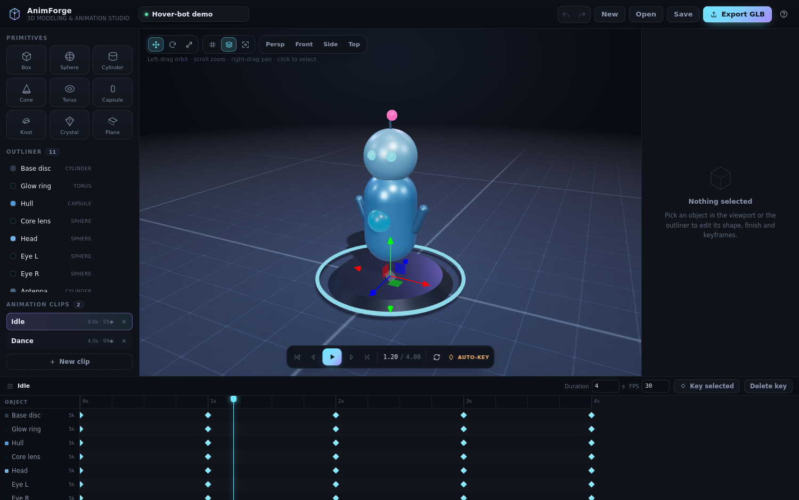

# AnimForge — 3D modelling & animation studio

A complete, browser-based tool for **building low-poly 3D models out of primitives and animating them with keyframes**, then exporting a game-engine-ready **GLB** (binary glTF) with every animation clip baked in.

No install, no accounts, no cloud — it's a single WebGL app. `three.js` is bundled locally, so it works fully offline.



▶ **Demo video:** [`animforge-demo.mp4`](animforge-demo.mp4) — 33 s walkthrough of the workflow (model → pose → material → keyframe → play → export).

---

## Run it

| How | What to do |
| --- | --- |
| **Quickest** | Open **`animforge-standalone.html`** — one self-contained file, works by double-clicking (no server needed). |
| **Local server** | `cd animforge && python3 -m http.server 8000` → visit `http://localhost:8000` |
| **Live preview** | A dev server is already running in this workspace on port **8000**. |

Your scene autosaves to `localStorage`; **Save** downloads an editable `.json` project.

---

## What you can do

### Model
- **9 primitives** — box, sphere, cylinder, cone, torus, capsule, torus-knot, crystal (icosahedron), plane. New shapes drop on the floor in front of the camera and are selected immediately.
- **Convert any shape** — the inspector's *Convert to* row turns the selected object into any other primitive in place, keeping its transform, material and keyframes (handy for "actually I wanted this to be a cone").
- **Taper & twist** — every primitive has two shared deformers: `Taper` (scale the top vs. the base, −0.9…1.5) and `Twist` (spiral about Y, ±180°). A tapered box becomes a truncated pyramid, a twisted cylinder becomes a screw — no modelling tools needed.
- **Transform gizmo** — move / rotate / scale, with optional 0.25-unit & 15° snapping.
- **Live shape parameters** — radius, height, segments, thickness… every primitive is re-generated as you drag.
- **PBR material editor** — base colour, metalness, roughness, opacity, emissive glow + power, wireframe, flat shading.
- **Outliner** — rename (double-click), hide, duplicate, delete. Multi-select with ⇧/⌘-click.
- Camera: orbit / pan / zoom, **Persp · Front · Side · Top** presets, **F** to frame the selection.

### Re-shaping a model you inserted

A library model is not a frozen import — it arrives as a **group** of ordinary primitives plus its clip:

| Action | How |
| --- | --- |
| Select the whole figure | Outliner → click the model's name, or inspector → **Select whole model** |
| Move / rotate / scale the figure | With the whole model selected, drag the **gizmo** — every part follows, feet stay planted |
| Change one part | Click a single part, then recolour it, drag its gizmo, or use **Convert to** / **Taper** / **Twist** as usual |
| Change the model as a shape | Convert a part to another primitive, add keyframes to it, delete a part — animation keeps playing |
| Undo a group | Ctrl+Z works across the group as one step |
| Split into independent objects | Inspector → **Split** (or outliner: group name → *split*) |
| Delete everything in one click | Inspector → **Delete model** |

Model groups are stored in the project file, so they survive save / load, undo and export.
Press **L** (or *Model library* in the left panel) for 15 ready-made, already-animated models. Each one is dropped in at a free spot, framed by the camera, and comes with its own clip so **Space** plays it right away:

| Category | Models |
| --- | --- |
| Humans | Walk · Run · Idle · Wave · Jump |
| Animals | Dog walk · Cat sit · Bird flap · Fish swim · Rabbit hop |
| Props | Tree sway · Rocket hover · Car drive · Drone fly · Planet orbit |

Tick **Add to current clip** and the model's animation is written into the clip you already have, so several characters can move together in one take — that is how the shot below (hover-bot + waving human + walking dog) was built: two inserts into the demo's `Idle` clip, one GLB export.

Nothing is imported or baked: every model is ordinary primitives with ordinary keyframe tracks, so you can recolour, convert or re-shape any part, retime the clip, or export the whole thing to GLB like a hand-built scene.

### Animate
- **Timeline** with frame-snapped playhead, ruler, per-object tracks and draggable keyframe diamonds.
- **Key** records the full transform (position + rotation + scale) at the playhead — via the **◆ Key** button, the inspector, or **K**.
- **Auto-key** (on by default): change a transform while the playhead is somewhere else and the new pose is recorded automatically.
- **Four interpolation modes** per key — double-click a diamond to cycle **Smooth → Linear → Ease in → Ease out**.
- **Multiple clips** (Idle, Dance, …) — each clip has its own duration and tracks, and each becomes a separate glTF animation on export.
- Playback with loop, frame stepping, jump-to-previous-key, adjustable duration and FPS (12–60).
- Full **undo / redo** (⌘/Ctrl+Z, ⌘/Ctrl+⇧+Z) with 90 steps of history.

### Export
- **GLB** — every clip is sampled at the project FPS and baked into `AnimationClip`s, then written by `GLTFExporter` as one binary glTF with named nodes and PBR materials. Tested to load back into three.js, and ready for Blender, Unity, Godot, Babylon, model-viewer or `<model-viewer>`-style AR.
- **PNG** — snapshot of the current viewport.
- **Project JSON** — re-openable, human-readable, version-friendly.

---

## Keyboard shortcuts

| Key | Action |
| --- | --- |
| `W` / `E` / `R` | move / rotate / scale gizmo |
| `Space` | play / pause |
| `K` | insert key at playhead |
| `←` `→` | step one frame |
| `Home` / `End` | jump to start / end |
| `F` | frame selection |
| `D` / `⌘D` | duplicate object |
| `L` | model library |
| `Del` | delete selected key, otherwise selected object(s) |
| `Esc` | deselect |
| `⌘/Ctrl Z`, `⌘/Ctrl ⇧ Z` | undo, redo |
| `⌘/Ctrl S` | save project JSON |
| `?` | help overlay |

---

## How it works (for the curious)

```
src/
  main.js        app bootstrap, render/playback loop, keyboard shortcuts
  project.js     document model: objects, clips, keyframes, interpolation,
                 undo history, autosave, demo scene generator
  primitives.js  primitive definitions, geometry builders, material helpers
  viewport.js    three.js scene, lighting, grid, gizmo, picking, framing
  timeline.js    ruler, tracks, keyframe diamonds, scrubbing & drag-retiming
  ui.js          inspector, outliner, clip list, transport, toasts
  exporter.js    GLB baking + PNG/JSON export
  library.js     15 prebuilt animated models (humans, animals, props)
```

- **No scene graph assumption:** the document stores flat world transforms per object, so keyframes are plain arrays (`{t, pos, rot, scale, ease}`). Rotation uses Euler degrees in the editor and is converted to quaternions (with hemisphere continuity) only when baking/exporting.
- **Preview and export use the same sampler** (`sampleTrack`), so what you see is what ships.
- **Rendering:** ACES tone mapping, PCF shadows, PMREM room environment for reflections, canvas-generated fading grid and shadow catcher.
- Two shipped clips (`Idle`, `Dance`) drive the demo hover-bot; the `Dance` clip orbits the eyes, arms and antenna around the spinning head so the whole rig reads correctly without parenting.

### Rebuilding

```bash
npm install          # three + esbuild
npm run build        # src → app.js (minified bundle, ~712 KB)
npm run standalone   # inlines CSS+JS into animforge-standalone.html
```

### Verified
22 automated browser checks cover: primitive creation, inspector edits, keyframe insert/auto-key/interpolation, undo/redo, keyframe drag-retiming, clip switching, GLB/PNG/JSON export, project re-open, autosave restore, playback, and a GLB round-trip through `GLTFLoader` (meshes, clips, node names, animation-driven transforms).

Library pass: all 15 presets insert, frame, animate and render without console errors; inserting two presets into the demo scene (11 → 39 objects, 2 → 4 clips) survives undo, save → reload and `buildExportGroup()`; every preset lands at the clicked spawn point with its limb pivots intact.

---

MIT-spirited: built on [three.js](https://threejs.org) (MIT).
